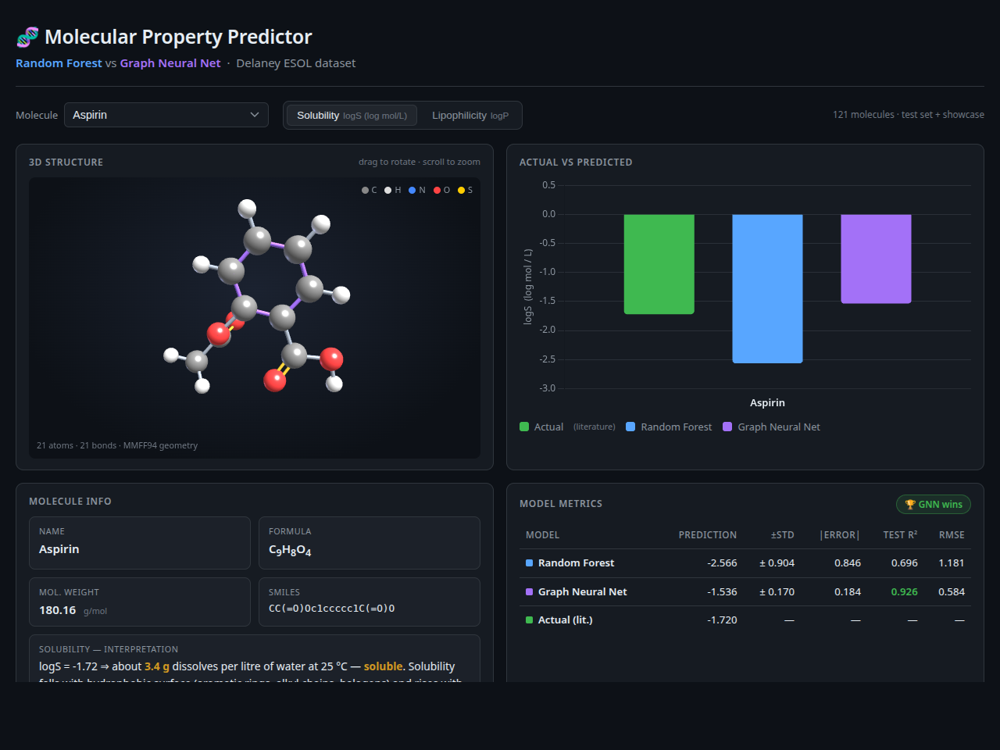

# Molecular Property Prediction
## RF vs GNN on the Delaney ESOL Dataset

### Overview
This project predicts aqueous solubility (logS, log mol/L) for small organic molecules from their structure alone, using two fundamentally different representations: a classical **Morgan-fingerprint + Random Forest** baseline and a **graph neural network (GIN)** that learns directly from the molecular graph. Both are trained and evaluated on identical splits of the Delaney ESOL dataset (1115 molecules; 888 train / 111 val / 116 test). The split is a single **random 80/10/10 split** (seed 42), with five showcase molecules forced into the test set. The results drive an interactive 3D dashboard.

### Demo
> Open [https://samhithanair.github.io/molecular-property-predictor/](https://samhithanair.github.io/molecular-property-predictor/)



### Methods
- **Approach A — Morgan Fingerprints + Random Forest.** Each molecule is encoded as a 2048-bit Morgan/ECFP4 fingerprint (radius 2) with RDKit. A `RandomForestRegressor` is tuned with 3-fold `GridSearchCV` over `n_estimators`, `max_features` and `min_samples_leaf` (selected: `{'max_features': 0.2, 'min_samples_leaf': 1, 'n_estimators': 600}`). Prediction uncertainty is the standard deviation across trees; explanations come from SHAP `TreeExplainer`.
- **Approach B — Graph Neural Network (GIN).** Atoms become nodes (37-dim features: element, degree, hybridisation, aromaticity, formal charge, attached H count) and bonds become edges (6-dim: bond type, conjugation, ring membership). Three `GINEConv` layers with residual connections and BatchNorm, global mean pooling and a 3-layer MLP head (128 hidden units, dropout 0.2). Trained with Adam + `ReduceLROnPlateau` and early stopping on validation RMSE (best epoch 39); uncertainty from 30-sample Monte-Carlo dropout. CPU only.

### Results
Held-out test set, 116 molecules (single random split, single seed):

| Metric | Random Forest | Graph Neural Net |
|--------|--------------|-----------------|
| RMSE   | 1.181 | 0.584 |
| MAE    | 0.903 | 0.448 |
| R²     | 0.696 | 0.926 |

The GNN outperforms the RF on R² (0.93 vs 0.70): binary fingerprints record *which* substructures are present but not molecular size or how many polar groups there are, which is exactly what drives solubility, whereas message passing over the full graph captures these global patterns. The RF, however, trains in seconds, needs no GPU and offers full SHAP explainability.

**Secondary demo target: RDKit Crippen logP.** Crippen logP is a *calculated* octanol-water partition estimate (a sum of atom-type contributions), not a measured quantity. It is used here only as a second regression target on the same splits and architectures, to show the pipeline generalising to another property. Results: RF R² 0.749 vs GNN R² 0.966. These predictions power the *Lipophilicity* tab of the dashboard.

### Per-molecule Predictions
Showcase molecules, sorted by |RF error| descending. The full export in `export_results.json` contains 121 molecules: the 116 ESOL test molecules plus the 5 literature molecules (†) described below.

| Molecule | Actual logS | RF pred | GNN pred | RF err | GNN err |
|----------|------------|---------|---------|--------|---------|
| water | 1.74 † | -0.72 | 2.34 | 2.46 | 0.60 |
| dopamine | -0.13 † | -1.69 | -1.17 | 1.56 | 1.04 |
| penicillin | -1.80 † | -3.34 | -3.63 | 1.54 | 1.83 |
| ethanol | 1.10 | -0.42 | 1.00 | 1.52 | 0.10 |
| paracetamol | -1.03 | -2.06 | -1.62 | 1.03 | 0.59 |
| glucose | 0.74 | -0.23 | 0.57 | 0.97 | 0.17 |
| aspirin | -1.72 † | -2.57 | -1.54 | 0.85 | 0.18 |
| caffeine | -0.88 | -1.69 | -1.03 | 0.82 | 0.15 |
| ibuprofen | -3.99 † | -3.31 | -3.46 | 0.68 | 0.53 |
| benzene | -1.64 | -1.46 | -1.40 | 0.18 | 0.24 |

† literature value (molecule not in ESOL); all others are ESOL measurements and were held out of training.

**Why 116 vs 121?** The metrics above are computed on the 116-molecule ESOL test split. The export has 121 rows because it also includes the five † molecules (water, dopamine, penicillin, aspirin, ibuprofen). These are not in ESOL, so they were never part of any train, validation or test split; their predictions are made by the trained models purely for display in the dashboard and are not included in the reported metrics.

### Explainability
SHAP (`TreeExplainer`, interventional) on the RF shows that the Morgan bits with the largest impact on predicted solubility encode aromatic carbons, aryl chlorides and aliphatic chain carbons — all pushing logS **down** (`[c]`, `[CH]`, `[Cl][c]`, `[CH2]([CH2][CH2])[CH2][CH2]`, `[cH]([c])[c]`, `[Cl]`, `[c](-[c])([cH])[c]`, `[CH2]([CH2])[CH2]`) — while carbonyl carbons and oxygen-centred environments push it **up** (`[C]`, `[O]`). This matches the chemical intuition that hydrophobic surface area lowers solubility and hydrogen-bonding groups raise it. See `figures/shap_beeswarm.png` and `figures/shap_top_bits.png`.

### Limitations
- **Small dataset.** ESOL has 1115 molecules, and the test set is only 116, so individual metrics and per-molecule errors are noisy.
- **Single split.** All numbers come from one random 80/10/10 split (seed 42). Different splits, such as scaffold splits that separate molecular families, would likely produce different scores, and the RF-vs-GNN gap may shift.
- **No repeated runs or error bars.** Each model was trained once, so the reported figures carry no variance estimate. Differences of a few hundredths in RMSE or R² should not be read as significant.
- **Literature values are not measurements from this study.** The five † values are taken from AqSolDB and the Yalkowsky handbook and are used only for display.
- **Crippen logP is calculated,** not measured, so the secondary target measures how well the models reproduce a rule-based estimate.

### Project Structure
```
molecular-property-predictor/
├── requirements.txt       # pip dependencies
├── notebook.ipynb         # full ML pipeline (EDA → RF → GNN → export → README)
├── export_results.json    # metrics + per-molecule predictions (generated)
├── coords.json            # RDKit 3D coordinates for every exported molecule (generated)
├── index.html             # standalone interactive frontend (Three.js + Chart.js)
├── README.md              # this file (generated)
├── preview.png            # screenshot of index.html
├── data/                  # delaney-processed.csv (downloaded on first run)
└── figures/               # plots saved by the notebook
```

### Setup
```bash
pip install -r requirements.txt
jupyter notebook notebook.ipynb      # run all cells (~1 min on CPU)
# then open index.html, or: python -m http.server  →  http://localhost:8000
```

### Tech Stack
Python · RDKit · scikit-learn · PyTorch Geometric · Three.js · Chart.js · SHAP
